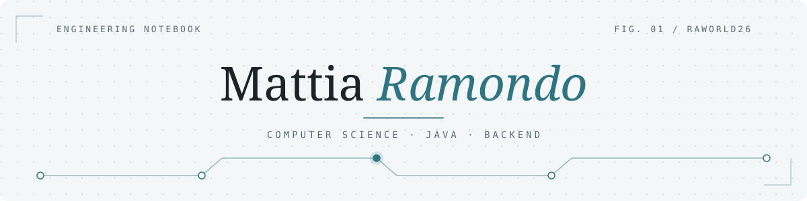

  <picture>
    <source media="(prefers-color-scheme: dark)" srcset="assets/header-dark.svg">
    <source media="(prefers-color-scheme: light)" srcset="assets/header-light.svg">
    
  </picture>

  <strong>Currently working in IT at Tiberina Sangro</strong> 
  Computer Science student at the University of L'Aquila 
  Java · Backend development · Software engineering

  <a href="#selected-projects">Projects</a> ·
  <a href="mailto:mattia.ramondo2004@gmail.com">Email</a> ·
  <a href="https://github.com/raworld26?tab=repositories">Repositories</a>

## About

I'm Mattia, a Computer Science student at the **University of L'Aquila** with a growing interest in **Java, backend development and software engineering**. Alongside my degree, I also work in IT at Tiberina Sangro.

What I enjoy most is the stretch where an idea becomes a clear design, working logic and an interface people can use. In university team projects I have worked on software design and diagrams, backend and application logic, and interface styling. I also helped fix backend issues and update content on a university website.

Docker, CI/CD and cloud computing are what I am learning next.

## Toolbox

**In use**

- **Languages and web:** Java, PHP, JavaScript, HTML, CSS, C, M68K, MIPS32
- **Data:** MySQL, MariaDB, SQL, SQLite
- **Java stack:** JavaFX, Maven
- **Workflow and OS:** Git, GitHub, Linux Mint

**Learning**

- Docker, CI/CD, cloud computing

## Selected projects

University team projects. My contribution varies from project to project, and none of them is solely my work.

- **[UniGest](https://github.com/raworld26/unigest)**: desktop application for exam sessions, bookings and grades. Java 21 · JavaFX · Maven · Jackson · JSON
- **[MasterRent](https://github.com/raworld26/MasterRent)**: university housing portal with filtered search and areas for students, owners and administrators. PHP · MySQL/MariaDB · HTML · CSS · JavaScript
- **[MasterDump](https://github.com/raworld26/MasterDump)**: web portal for purchase requests, approvals and technician assignments. PHP · MySQL · HTML · CSS
- **[SafeDriveMonitor](https://github.com/raworld26/SafeDriveMonitor)**: educational desktop prototype with simulated tests, accounts, results and an admin panel. Java · JavaFX · Maven · SQLite

## Contact

Interested in Java, backend development or software engineering? Write to [mattia.ramondo2004@gmail.com](mailto:mattia.ramondo2004@gmail.com) or browse my [repositories](https://github.com/raworld26?tab=repositories).
